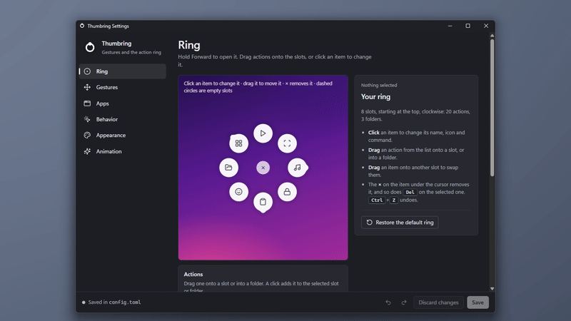
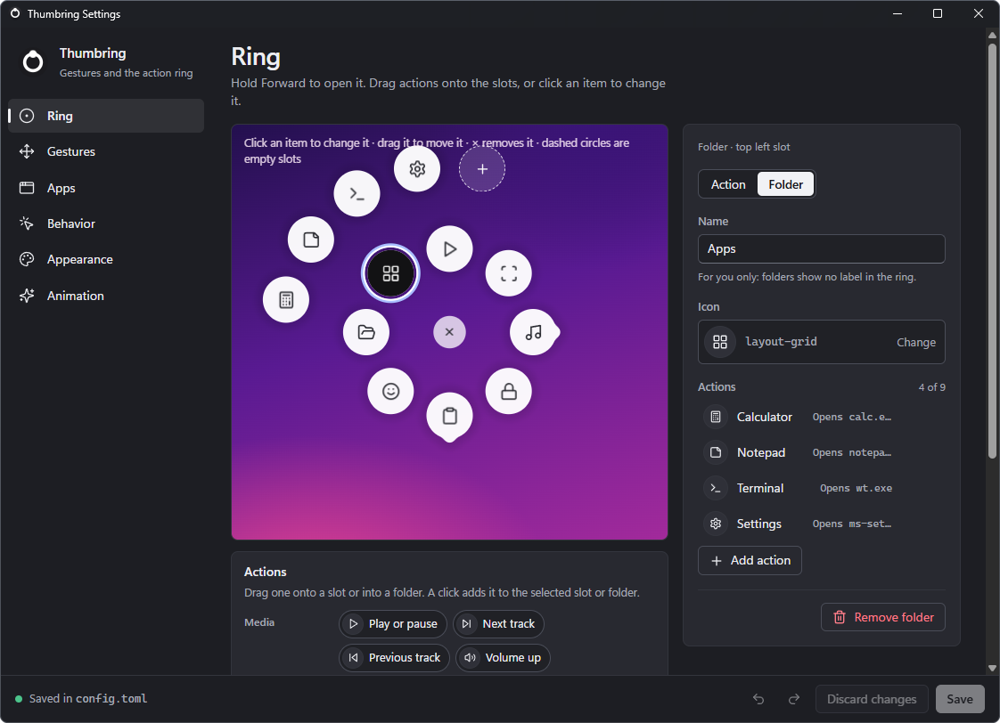
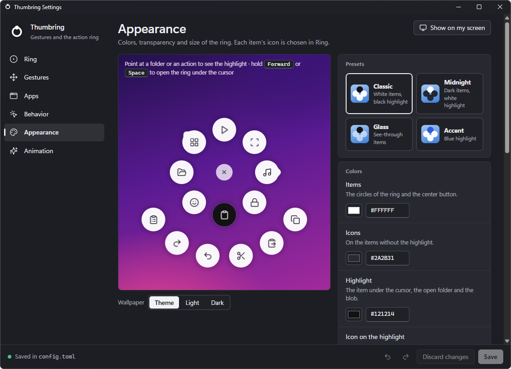

# Thumbring

**Mouse gestures and a radial action ring for Windows, on any mouse.**

[](https://github.com/iglesiaskun/thumbring/actions/workflows/ci.yml)
[](https://github.com/iglesiaskun/thumbring/releases/latest)
[](#license)

[Leia em português](README.pt-BR.md)


Hold **Forward** and a ring of actions opens around the cursor. Hold **Back**
and drag to run a gesture. A quick tap on either button still goes back or
forward, as it always did.

## Why Thumbring

It is light: a small program that sleeps until you hold a mouse button. It
works with any mouse that has side buttons, or with the middle button. It
needs no account, collects nothing, makes no network connections, and it is
free and open source.

## Features

### Gestures on the Back button



Hold the mouse Back button, drag about 3 cm and release:

| Gesture | Default |
|---|---|
| Up | `Win+Tab` (Task View) |
| Down | `Win+D` (show the desktop) |
| Left | `Ctrl+Win+Right` (next virtual desktop) |
| Right | `Ctrl+Win+Left` (previous virtual desktop) |
| Quick tap | Back, as usual |

A gesture, like a ring action, can press a keyboard shortcut or a media key,
open an app, a file, a folder or a URL, or run a built-in action (screenshot,
emoji panel, File Explorer, lock screen).

### An action ring with folders

Hold the Forward button for a moment: the ring opens around the cursor. It
has 8 slots, and each one holds an action or a folder with up to 9 actions.
Point at an item and click it, or release Forward and click afterwards: the
ring stays open wherever you release it, even on the center. A folder opens
when the cursor rests on it. A click on the × in the center, a click outside
the ring, a right click, Esc, Forward again or switching windows closes it
without running anything. While the ring is open, clicks and the mouse wheel
never reach the window below. In quick mode (`execute_on_release = true`
under `[behavior]`), releasing over an action runs it and releasing on the
center closes the ring.

| Default ring (clockwise from the top) | Does |
|---|---|
| Play or pause | `PlayPause` |
| Screenshot | snipping screenshot |
| Media (folder) | previous and next track, volume down and up, mute |
| Lock screen | locks the session |
| Editing (folder) | copy, paste, cut, undo, redo, clipboard history |
| Emoji | emoji panel |
| File Explorer | opens File Explorer |
| Apps (folder) | Calculator, Notepad, Terminal, Settings |

### A settings window with a live preview



Right-click the tray icon > **Open settings**. The window has a page for each
part of Thumbring:

| Page | What it changes |
|---|---|
| Ring | the 8 slots, on a live preview: drag actions onto the slots, open folders, pick an icon or use an SVG or PNG of your own, record a shortcut |
| Gestures | the command of each direction and how far to drag, with a pad to try them |
| Apps | where Thumbring stays off (fullscreen, excluded apps) and per-app gesture profiles |
| Behavior | which mouse buttons run the gestures and open the ring, and how the ring opens |
| Appearance | colors, transparency, size and distance of the items, shadow and label; **Show on my screen** shows the ring for real before you save |
| Animation | the style and speed of the animation, with a slow-motion demo |

Nothing changes until you click **Save** (`Ctrl+S`); `Ctrl+Z` and `Ctrl+Y`
undo and redo. Thumbring uses the saved settings at once, and the window says
so. The window writes the settings file described in
["Settings file reference"](#settings-file-reference) and keeps its comments,
so you can use either one.

### Profiles for each app

A profile changes only the gestures it lists, in the apps you choose: left
and right can switch tabs in your browser and desktops everywhere else.
Thumbring also turns itself off in the apps you exclude and while an app is
fullscreen, and a click on the tray icon pauses it.

### Your colors and your animation



Pick a preset (Classic, Midnight, Glass or Accent) or set each color, the
transparency, the size and distance of the items, the shadow and the label.
The animation comes in two styles, viscous and elastic, with its speed and
timings yours to change.

### Any button for either job

Gestures and the ring can each use Back, Forward or the middle button
(pressing the wheel), so a mouse without side buttons works too.

## Install

Thumbring 0.1.0 is the first public release. What changed in each version is
in the [changelog](CHANGELOG.md).

Requirements:

- Windows 10 or 11, 64-bit.
- A mouse with the two side buttons, Back and Forward. On a mouse without
  them, the middle button can run the gestures or open the ring instead.
- For the settings window, the WebView2 Runtime, the part of Windows that
  shows web pages inside apps. Windows 11 comes with it, and Windows Update
  has already installed it on most Windows 10 computers. Where it is missing,
  **Open settings** shows a message with the link to download it, for free;
  everything else in Thumbring works without it, and the settings file can
  still be edited by hand (tray menu > **Open settings file**).

To install:

1. Download the latest version from the
   [Releases page](https://github.com/iglesiaskun/thumbring/releases/latest):
   - **`thumbring-<version>-windows-x64.msi`** (recommended) installs Thumbring
     for your user only, without administrator rights, adds it to the Start
     menu and starts it. To update, run the newer `.msi`.
   - **`thumbring-<version>-windows-x64.zip`** runs without installing: unzip
     it anywhere and start `thumbring.exe`.
2. Windows will probably show "Windows protected your PC": the files are not
   code-signed yet, and SmartScreen warns about new programs that have no
   reputation. Click **More info** and then **Run anyway**.
   ["Known limitations"](#known-limitations) explains why and how to check
   that a download is the one GitHub built from this repository.
3. On the first run, a notification says that Thumbring is running. Its icon
   is in the notification area, next to the clock; Windows may hide it behind
   the **^** arrow. To keep it in sight, drag it to the taskbar.
4. To start Thumbring with Windows, right-click its icon and check
   **Start with Windows**. To use it in windows that run as administrator
   too, check **Start with Windows as administrator** instead;
   ["Known limitations"](#known-limitations) explains it.

**Uninstall.** With the `.msi`, remove Thumbring in Settings > Apps >
Installed apps; that also stops it from starting with Windows. With the
`.zip`, first right-click the tray icon and uncheck **Start with Windows** (or
**Start with Windows as administrator**), then quit Thumbring and delete its
folder. Your settings and the log stay in `%APPDATA%\thumbring` and
`%LOCALAPPDATA%\thumbring`; delete those folders to remove everything.

## Getting started

1. **Hold Forward** to open the ring, point at an action and click it.
2. **Hold Back and drag** up, down, left or right to run a gesture.
3. **Right-click the tray icon > Open settings** to change the ring, the
   gestures and the buttons.

Click the tray icon to pause or resume Thumbring. Right-click it for the menu:
pause, open the settings window, open the settings file, open the log, start
with Windows (normally or as administrator) and quit.

## Known limitations

**Windows that run as administrator.** Windows does not let a program without
administrator rights watch or send input to windows that run as administrator,
such as Task Manager, an administrator terminal or some installers. While one
of them is in front, gestures and the ring do not work there, unless Thumbring
has administrator rights too:

1. Right-click the tray icon and check **Start with Windows as
   administrator**. Windows asks for permission once (the UAC prompt) and
   creates a task, "Thumbring (your user name)", in Task Scheduler.
2. From the next sign-in, that task starts Thumbring with administrator
   rights, without asking.

The apps that Thumbring opens (`open:` commands, the settings file, the log)
still run without administrator rights: File Explorer opens them, and if
Explorer does not answer, Thumbring opens nothing and says so. Unchecking
the option, or checking **Start with Windows**, deletes the task. After an
update, the installer starts Thumbring without administrator rights until the
next sign-in.

Think before you turn it on. A program that starts with administrator rights
is only as safe as its folder, and the `.msi` installs Thumbring in your user
folder, where any program you run can write. A malicious program could replace
`thumbring.exe` there and get administrator rights at your next sign-in,
without a UAC prompt. If that worries you, leave the option off, or unzip the
`.zip` into a folder that only administrators can change, such as
`C:\Program Files\Thumbring`, and turn the option on from the Thumbring in
that folder. For the same reason, while it has administrator rights,
Thumbring ignores mouse button presses that other programs simulate, such as
remote control tools or software that remaps mouse buttons: only the real
mouse buttons run gestures and open the ring.

**Games and anti-cheat.** Thumbring uses the same Windows features as macro
tools: a low-level mouse hook and simulated key presses. Some anti-cheat
systems block or flag programs that do this. Thumbring turns itself off while
an app is fullscreen, but a game in a borderless window may not count as
fullscreen. Before playing online, pause Thumbring from the tray or add the
game's `.exe` to `excluded` under `[apps]` in the settings file.

**Warnings from SmartScreen and antivirus programs.** The release files are
not code-signed yet: a certificate is expensive for a free project, and the
plan is to apply for free signing for open source projects now that the first
version is out. Until then, Windows
SmartScreen warns about a new program with no reputation ("Windows protected
your PC"), and an antivirus may distrust an unknown program that hooks the
mouse and simulates key presses, which is exactly what Thumbring does. To make
sure a download is the one GitHub built from this repository:

- compare the output of `Get-FileHash <file>` in PowerShell with the line for
  that file in `SHA256SUMS`, from the same release;
- or, with the [GitHub CLI](https://cli.github.com), run
  `gh attestation verify <file> --repo iglesiaskun/thumbring`.

You can also build Thumbring from the source code yourself, as
[CONTRIBUTING.md](CONTRIBUTING.md#building-from-source) explains.

**Mouse software.** If your mouse's own software maps the side buttons to
something else, Thumbring no longer sees them as Back and Forward. Set them
back to Back and Forward (or "default") in that software.

**Settings window without WebView2.** On a computer without the WebView2
Runtime (see "Install"), the settings window does not open; it says where to
get the runtime instead. Gestures, the ring and the settings file work as
usual.

**Windows only, in English.** Thumbring runs only on Windows for now, and its
menus, messages and settings window are in English.

## FAQ

**Does Thumbring collect data or use the internet?**
No. It makes no network connections. The log stays on your computer; it lists
the names of the apps you focus, which helps when writing profiles.

**Does it work with my mouse?**
Yes. By default Thumbring uses the two side buttons, Back and Forward
(sometimes called buttons 4 and 5). On a mouse without them, choose the
middle button for the gestures or the ring in the settings window (Behavior >
Mouse buttons), or write `button = "middle"` under `[gestures]` or under
`[ring]` in the settings file, and pressing the wheel runs the gestures or
opens the ring.

**How do I change the gestures or the ring?**
Right-click the tray icon > Open settings, change what you want and save.
Thumbring uses the new settings at once. You can also edit the file itself:
tray menu > Open settings file; ["Settings file reference"](#settings-file-reference)
below explains the options.

**Open settings opens the settings file, or says WebView2 is missing. Why?**
The settings window is a separate program, `thumbring-settings.exe`, which
must sit next to `thumbring.exe` (the `.msi` and the `.zip` put it there), and
it needs the WebView2 Runtime. Without the program, Thumbring opens the
settings file instead and says so; without the runtime, the window shows the
link to download it. Gestures and the ring keep working either way.

**How do I go back to the default settings?**
Quit Thumbring, delete `%APPDATA%\thumbring\config.toml` and start Thumbring
again: it creates a new file with the defaults.

**Gestures do not work in Task Manager or in an administrator terminal. Why?**
Those windows run as administrator, and Windows keeps programs without those
rights away from them. Check **Start with Windows as administrator** in the
tray menu and sign in again; "Known limitations" above explains the
trade-off.

**Gestures stopped working. What now?**
Check the tray icon: a dimmed ring means Thumbring is paused, off in an
excluded app or off because an app is fullscreen; its tooltip says which.
Remember the limitation with windows that run as administrator. If none of
these explains it, the log (tray menu > Open log) usually does; please
[open an issue](https://github.com/iglesiaskun/thumbring/issues/new/choose) with the
relevant lines.

**Why "Thumbring"?**
The thumb works the side buttons, and the ring opens around the cursor.

## Roadmap

This first release is small on purpose, and what people say about it shapes
the next ones. On the list so far:

- Code-signed releases, through a free signing program for open source
  projects, so SmartScreen stops warning.
- macOS and Linux, one day: the logic in `core/` stays free of Windows APIs
  for that.

Ideas are welcome as [feature requests](https://github.com/iglesiaskun/thumbring/issues/new/choose).

## Contributing

Bug reports, ideas and pull requests are welcome.
[CONTRIBUTING.md](CONTRIBUTING.md) explains how changes get in and how to
build Thumbring from source.

## Security

Please report security problems privately, as [SECURITY.md](SECURITY.md)
explains.

## License

Thumbring is dual licensed under the [MIT license](LICENSE-MIT) or the
[Apache License, Version 2.0](LICENSE-APACHE), at your option.

The icons of the ring and of the settings window come from
[Lucide](https://lucide.dev), under the ISC license
([LICENSE-LUCIDE](engine/assets/icons/LICENSE-LUCIDE)).

## Settings file reference

Everything here can be changed in the settings window. The settings file
behind it is `%APPDATA%\thumbring\config.toml`. Thumbring creates
it on the first run with every default and a comment for each option (the
template is [`core/src/config/default.toml`](core/src/config/default.toml)),
and reloads it every time it is saved. An invalid or out-of-range value falls
back to its default and shows a warning instead of crashing; a file that
cannot be parsed keeps the previous settings. The log is at
`%LOCALAPPDATA%\thumbring\engine.log` (tray menu > Open log), and it also
shows the `.exe` name of every app that gets focus.

The first line, `version = 1`, is the format of the file. If a future version
changes the format, Thumbring uses this number to update older files. A file
without it counts as version 1.

```toml
version = 1

[gestures]
button = "back"             # "back", "forward" or "middle"
up = "Win+Tab"
down = "Win+D"
left = "Ctrl+Win+Right"
right = "Ctrl+Win+Left"
click = "native"
threshold_px = 30           # at 100% scaling; grows with the monitor DPI

[apps]
disable_in_fullscreen = true
excluded = ["mstsc.exe"]    # the button works as usual in these apps

# A profile changes only the gestures it lists.
[[profiles]]
name = "Browser"
apps = ["browser.exe"]      # the executable of your browser
gestures = { left = "Ctrl+Tab", right = "Ctrl+Shift+Tab" }
```

`button` under `[gestures]` is the button that runs the gestures, and
`button` under `[ring]` the one that opens the ring: `"back"`, `"forward"` or
`"middle"` (pressing the wheel). They are Back and Forward unless you change
them. One button cannot do both: if the two name the same button, both go
back to their defaults, with a warning. While the ring is off, the gestures
may use its button. A quick tap, like the `"native"` command, sends the click
of the button that was held.

Commands, for gestures and ring actions alike:

| Text | Does |
|---|---|
| `"Ctrl+Shift+T"` | keyboard shortcut (Ctrl, Win, Alt, Shift plus one key) |
| `"VolumeUp"`, `"PlayPause"`, `"NextTrack"` | media and volume keys |
| `'open:C:\Users\you\Downloads'`, `'open:https://...'` | opens an app, file, folder or URL; `%VARIABLES%` are expanded |
| `'open:"C:\Program Files\App\app.exe" --option'` | the same, with arguments |
| `"screenshot"`, `"emoji"`, `"explorer"`, `"lock"` | built-in actions |
| `"native"` | what the button does without Thumbring |
| `"none"` | nothing (turns a gesture off in a profile) |

The ring is configured in the same file, which comes with the default ring
written out. It has 8 slots, starting at the top, clockwise; each one holds an
action, a folder with up to 9 actions, or nothing (`type = "empty"`). Saved
changes apply the next time the ring opens. To turn the ring off and keep its
button as it always was, leave the list empty: `slots = []` under `[ring]`.

Icons: `calculator`, `calendar`, `clipboard`, `clipboard-list`,
`clipboard-paste`, `code`, `copy`, `folder-open`, `globe`, `headphones`,
`layout-grid`, `lock`, `mail`, `music`, `play`, `redo-2`, `scan`, `scissors`,
`settings`, `skip-back`, `skip-forward`, `smile`, `sticky-note`, `terminal`,
`undo-2`, `volume-1`, `volume-2`, `volume-x` and `x`. An icon can also be an
SVG or PNG file of your own, by its full path, such as
`icon = 'C:\Users\you\Pictures\star.svg'` (`%VARIABLES%` work, and files go up
to 2 MB). An SVG takes the icon colors wherever it uses `currentColor` or sets
no color; its other colors stay, and a PNG keeps its own. Thumbring reads the
file when the settings load, so after changing the picture, save the settings
again. Without an icon, or with an unknown one or a file that cannot be read
(which logs a warning), the item shows the first letter of its name.

The optional `[appearance]` section changes the colors, the transparency and
the size of the ring. Without it, the ring looks as it always did: the values
below are the defaults. Colors are written as `"#RRGGBB"`.

```toml
[appearance]
item_color = "#FFFFFF"            # the items and the center button
item_opacity = 0.96               # 0.3 to 1; the highlight is always solid
icon_color = "#2A2B31"
highlight_color = "#121214"       # item under the cursor, open folder, blob
highlight_icon_color = "#FFFFFF"
cancel_color = "#E64054"          # center button under the cursor: it closes
item_size_px = 52                 # item diameter at 100% scaling, 32 to 96
ring_radius_px = 93.6             # distance from the center to each item
shadow = true                     # soft shadow around the items
label = "light"                   # "light" or "dark"
```

`ring_radius_px` goes from 1.5 to 3 times `item_size_px`, so the items never
touch; without it, it is 1.8 times `item_size_px`. Folders open twice as far
from the center, and the center button follows the item size. The sizes are
at 100% scaling and grow with the monitor scale; on a monitor too small for
an open folder, the ring shrinks as a whole. For dark items, try
`item_color = "#1F2026"`, `icon_color = "#E8E9EE"`,
`highlight_color = "#FFFFFF"`, `highlight_icon_color = "#16171B"` and
`label = "dark"`.

```toml
[animation]
style = "viscous"     # or "elastic"
speed = 1.0           # 0.5 to 2.0

[behavior]
open_with = "hold"    # or "tap"
hold_to_open_ms = 150
path_tolerance_ms = 50

[ring]
button = "forward"    # "forward", "back" or "middle"

[[ring.slots]]
type = "action"
name = "Screenshot"
icon = "scan"
command = "Win+Shift+S"

[[ring.slots]]
type = "folder"
name = "Media"
icon = "music"
items = [
  { name = "Mute", icon = "volume-x", command = "VolumeMute" },
]
```
